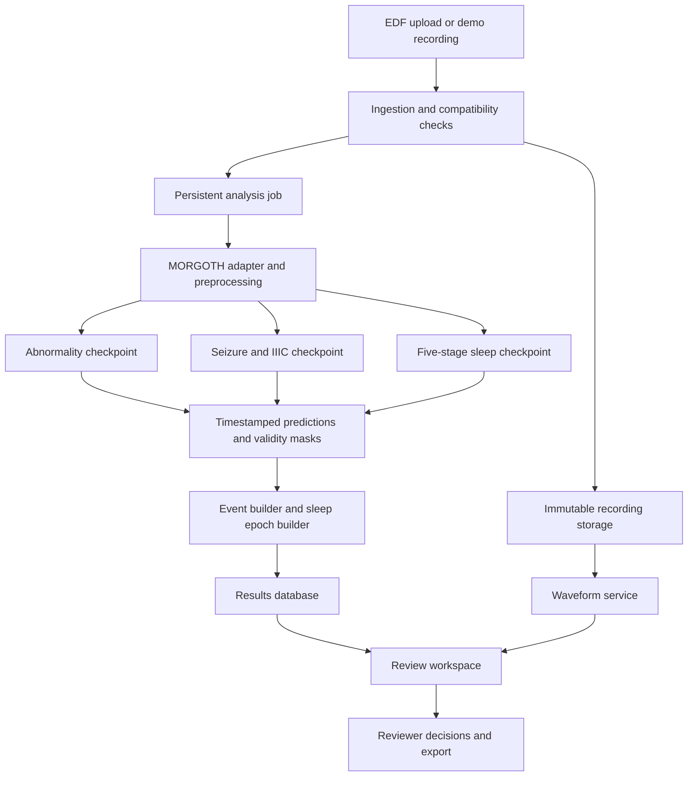

# NeuroScope AI — product and system architecture

Version 1 · 15 November 2026 · Original architecture baseline. Implementation decisions and deviations are recorded in [IMPLEMENTATION.md](IMPLEMENTATION.md); actual verification is recorded in [BUILD_REPORT.md](BUILD_REPORT.md).

**Product:** an EEG review workspace that uses pretrained MORGOTH models to produce timestamped abnormality flags, possible seizure events, and a sleep-stage timeline. Every finding links back to the original waveform and can be reviewed by a person.

**Initial scope:** offline analysis of existing recordings for a hackathon research prototype. No manual training labels, training from scratch, or chatbot is required. MORGOTH supplies the learned models; NeuroScope supplies ingestion, reliable timing, event construction, visualization, review, and evaluation.

## 1. Verified model fit and dependencies

The MORGOTH repository documents normal/abnormal scoring, seizure and related rhythmic/periodic pattern classification, spikes, slowing, burst suppression, and five-stage sleep classification. It exposes task-specific checkpoints and continuous inference. Its README currently points to credentialed S3 storage for weights. [Official repository](https://github.com/bdsp-core/morgoth)

The resource page still mentions an older Dropbox distribution route. Treat weight availability as an unresolved implementation dependency: verify the authorized download route, required checkpoints, and their terms before running inference. No weights have been downloaded or executed during this design. [Official release](https://bdsp.io/content/morgoth1/1.0.0/)

The repository license is CC BY-NC 4.0 and explicitly prohibits commercial use. This design targets a research prototype; a commercial NeuroScope release needs appropriate rights or a differently licensed model. Do not assume the code license alone establishes permission to redistribute weights or recordings. [Repository license](https://github.com/bdsp-core/morgoth/blob/main/LICENSE)

## 2. User experience

1. **Import:** select a demo recording or upload an EDF. Show duration, available channels, and supported analyses.
2. **Analyze:** start a background job; show progress separately for abnormality, seizure-related patterns, and sleep.
3. **Review:** a synchronized waveform viewer, event queue, score tracks, and sleep hypnogram share one time cursor.
4. **Inspect:** clicking a flag opens its estimated interval with 20 seconds of context on either side, clipped to available recording time.
5. **Decide:** accept, reject, or mark uncertain; edit boundaries or sleep stages; add notes and manually mark missed events.
6. **Export:** save machine predictions and reviewer decisions as distinct fields in JSON/CSV and a printable report.

Proposed workspace:

```text
Recording selector | Analysis status | Coverage | Export
-------------------------------------------------------
Full-recording timeline: events / sleep / unscored gaps
-------------------------------------------------------
Review queue       | Multichannel EEG viewer
Filters and counts | Time cursor, zoom, montage controls
                   | Model score tracks
-------------------------------------------------------
Selected finding   | Predicted sleep-stage hypnogram
Scores + review    | Stage duration and valid coverage
```

Possible seizures appear first in the default queue, followed by other flagged patterns. This is a review-order rule, not a clinical severity score. Scores from different heads are not directly ranked against each other. Sleep stages remain a separate contextual track rather than an alarm list.

## 3. System overview



The boxes are modules in one application, not a fleet of microservices. Start with one web frontend, one Python API, and one inference worker on a single machine. The worker can later move to a GPU host without changing the review interface.

## 4. Model integration

| Product capability | Initial MORGOTH task | NeuroScope output |
|---|---|---|
| Abnormal activity | `NORMAL.pth` | Estimated abnormal intervals and a score track |
| Possible seizures | `IIIC.pth` | Possible seizure intervals; other rhythmic/periodic classes kept separately |
| Sleep patterns | `SLEEPPSG.pth` | Awake, N1, N2, N3, REM timeline and duration summaries |
| Expanded abnormality detail | Later: spikes, slowing, burst suppression checkpoints | Additional typed event tracks |

The official scripts specify separate checkpoints, including a six-channel five-stage sleep configuration and a distinct three-stage sleep model. NeuroScope must not silently substitute the three-stage model for five-stage analysis. [Continuous inference script](https://github.com/bdsp-core/morgoth/blob/main/continuous_event_level.sh)

Use a `MorgothAdapter` with operations for capability checks, preparation, prediction, and output validation. Keep checkpoints frozen. Run task checkpoints separately initially; do not assume their backbones share weights or can reuse embeddings without verification.

The adapter registry records each checkpoint's checksum, upstream commit, class order, binary positive-class meaning, channels, reference, preprocessing, window length, stride, and output semantics. Explicitly verify whether the binary `NORMAL` output represents normality or abnormality before displaying an abnormal score. Never infer this from the filename.

Pin a tested upstream revision and dependencies at implementation time. Use one inference process initially, scheduling heads sequentially to limit memory. Benchmark CPU and GPU execution before promising turnaround time. GPU deployment is preferred if available; CPU is a tested fallback only after runtime verification.

## 5. Ingestion, channel compatibility, and signal handling

EDF is the user-facing MVP format. An internal MAT adapter can support authorized model examples. Retain the original recording; store normalized metadata and chunk offsets separately.

For each file, validate duration, sample rates, units, channel names, reference/montage, discontinuities, duplicate channels, and readable sample ranges. Reject corrupt files and report unsupported analyses individually.

The inspected code uses 19-channel configurations for the main EEG tasks, while the five-stage sleep path selects F3, C3, O1, F4, C4, O2 or supported referenced equivalents. It uses 10-second windows for the core tasks and one-second windows for the spike task. [MORGOTH input and window implementation](https://github.com/bdsp-core/morgoth/blob/main/utils.py)

Design decisions:

- Require a supported reference and channel set for each head in the MVP. Do not silently impute absent electrodes.
- Normalize recognized electrode aliases only; do not turn a bipolar difference such as `FP1-F7` into an electrode named `FP1`.
- Validate our sample recordings before selecting a demo dataset. The earlier CHB-MIT proposal is not a commitment to input compatibility with MORGOTH.
- Preserve units and reference provenance through every conversion.
- Reuse the verified upstream preprocessing once; avoid double filtering or re-referencing.
- Keep display filters independent of inference. Changing the waveform view must not change cached predictions.
- Record flat signals, missing samples, invalid windows, and unsupported sections as quality/coverage information. These checks are not a trained artifact classifier.

## 6. Timestamp contract and long recordings

Canonical time is elapsed time from the original recording's start. Use integer source-sample positions within continuous segments, with an explicit segment-to-recording time map. Store intervals as half-open `[start, end)` ranges.

For every model window retain:

```text
recording_id, analysis_run_id, head_id, chunk_id
source_segment_id, source_start_sample, source_end_sample
support_start_ms, support_end_ms, anchor_ms
class_scores, valid, invalid_reason
checkpoint_hash, preprocessing_version
```

Do not reconstruct timestamps solely from CSV row numbers. Retain the true window positions, valid-window mask, and any interpolation applied by the upstream pipeline. Prediction stride controls sampling density, not verified onset accuracy.

Proposed scheduling unit: 10-minute core chunks with context on both sides. Compute context from each head's window and filter requirements, verified against unchunked inference. Persist each chunk's offset; trim context outputs and deduplicate overlaps. Keep filtering away from unhandled boundaries. Do not merge across recording gaps.

For files with discontinuous segments, preserve elapsed-time gaps. End-of-file windows without enough support remain unscored unless a separately validated padding policy is introduced. Wall-clock times are optional and shown only when the source start time and timezone are trustworthy.

The inspected inference implementation can initialize invalid regions with zero or a default first-class score, and can fill missing values. The adapter must carry validity independently and expose these intervals as **unscored**, never as normal or awake. Interpolated scores must remain distinguishable from actual model evaluations. [Inference implementation](https://github.com/bdsp-core/morgoth/blob/main/finetune_classification.py)

## 7. Turning predictions into events

**Abnormality and seizure-related events:** preserve the raw score series; apply task-specific thresholds, persistence rules, and gap merging as a versioned postprocessing configuration. Use separate enter/exit thresholds to reduce flickering. Select numeric settings on validation recordings; they are not established clinical thresholds.

Each candidate contains estimated start/end, task and class, peak and mean model scores, supporting prediction references, coverage flags, and a review status. Duration rules are task-specific: a rule designed for sustained seizure candidates must not erase brief spike candidates when those are added.

Retain non-seizure IIIC classes under their own names; do not relabel every rhythmic or periodic pattern as a seizure. A broad abnormality flag may overlap a seizure flag. Group their presentation but preserve both source predictions. Do not require the broad abnormality head to agree before retaining a seizure candidate.

Model boundaries remain estimates. The interface exposes the supporting windows and surrounding waveform. Reviewer edits create a separate annotation version rather than overwriting model output. No precise seizure source localization is promised from global class scores.

**Sleep timeline:** keep native five-class scores. For a proposed 30-second display epoch, average valid prediction scores whose window centers fall inside that epoch, then choose the highest-scoring stage. Require at least 80% of the expected centers to be valid; otherwise mark it unscored. This is an initial engineering rule to evaluate, not a validated sleep-scoring standard. Preserve native predictions so aggregation can be changed without rerunning MORGOTH.

Allow an uncertain state using a separately validated score/margin rule. Consecutive epochs of the same stage form display segments; retaining the original epoch boundaries allows corrections and comparison with labels. Initially show predicted stage durations, percentages of scored time, and unscored duration. No apnea, limb-movement, or sleep-disorder diagnosis is included.

## 8. Application components and storage

| Component | Proposed technology | Responsibility |
|---|---|---|
| Web interface | React + TypeScript + Vite | Synchronized review workspace |
| Waveforms and score plots | Plotly.js | Time navigation and channel display |
| API | Python + FastAPI | Uploads, jobs, results, annotations, export |
| EEG handling | MNE-Python + NumPy | Metadata, waveform reads, validated conversions |
| Model execution | PyTorch + pinned MORGOTH code | Frozen checkpoint inference |
| Worker | Separate Python process | Persistent job execution and chunk recovery |
| Metadata | SQLite | Recordings, jobs, capabilities, events, reviews |
| Large arrays/files | Local filesystem; Parquet for predictions | Original files, waveform cache, prediction blocks |

SQLite stores a job queue polled by the single worker; inference never runs inside an HTTP request. A heartbeat/lease detects interrupted work, and completed chunk artifacts permit resume. Writes are atomic. Retries reuse a cache key containing the input hash, checkpoint hash, preprocessing version, and analysis configuration.

Analysis states: `queued`, `validating`, `running`, `postprocessing`, `complete`, `partial`, `failed`, `cancelled`. Each head also has its own state. If sleep succeeds but seizure analysis fails, show the sleep result and the failure explicitly. Store coverage per head; “no flags” is not equivalent to a fully analyzed normal recording.

Waveform requests specify channels, time range, and display resolution. Return min/max envelopes for long overviews and high-resolution samples when zoomed in. Do not download a full overnight waveform into the browser. Models always consume the validated signal, never the decimated display cache.

Core records: `Recording`, `AnalysisRun`, `TaskRun`, `PredictionBlock`, `CandidateEvent`, `SleepEpoch`, `QualityInterval`, `ReviewAnnotation`, `ExportManifest`. Large scores stay outside SQLite. Reviews refer to immutable prediction IDs and record author, timestamp, original value, and correction.

## 9. API and code boundaries

| Endpoint | Purpose |
|---|---|
| `POST /recordings` | Upload EDF and return recording ID |
| `GET /recordings/{id}/capabilities` | Supported tasks and channel issues |
| `POST /recordings/{id}/analyses` | Queue selected tasks and return run ID |
| `GET /analyses/{id}` | Per-head progress, errors, and coverage |
| `POST /analyses/{id}/cancel` | Request worker cancellation |
| `GET /recordings/{id}/waveform` | Read a selected time/channel range |
| `GET /analyses/{id}/events` | Filterable timestamped candidates |
| `GET /analyses/{id}/sleep` | Sleep epochs, scores, and coverage |
| `POST /analyses/{id}/annotations` | Append a review or manual finding |
| `GET /analyses/{id}/export` | Export predictions and review history |

Proposed implementation layout:

```text
neuroscope/
  frontend/src/       # workspace, timeline, viewer, review panel
  backend/api/        # request validation and endpoints
  backend/domain/     # recording, prediction, event, review contracts
  backend/ingest/     # file validation, channels, time mapping
  backend/models/     # MORGOTH adapter and checkpoint registry
  backend/pipeline/   # chunking, validity, events, sleep aggregation
  backend/worker/     # persistent jobs, caching, cancellation
  backend/storage/    # database and array/file access
  evaluation/         # dataset manifests and task-specific evaluation
  tests/              # timing, compatibility, contracts, integration
  configs/            # model and postprocessing manifests
```

No LLM sits between model output and event labels. Any initial explanatory text is templated from actual scores, computed measurements, and review status.

## 10. Deployment and data boundary

First deployment: local single-user workspace, with a Python worker on the same machine or a controlled GPU host. Bind locally by default. Keep original EDF files, model weights, and credentials out of public Git history. Recordings and model credentials remain server-side.

A public hackathon demo should expose only recordings and derived artifacts whose sharing terms permit it. Public arbitrary uploads are outside the initial deployment. Remote private uploads require authenticated access, authorization on each recording, encrypted transport/storage, deletion handling, and an explicit retention policy before enabling them. Metadata logs should use recording IDs rather than patient-identifying headers.

## 11. Evaluation and acceptance criteria

Use existing annotated datasets; the user does not need to create labels. Select compatible, authorized recordings for each task. No single dataset should be assumed to label seizures, all abnormalities, and sleep simultaneously. Audit overlap with MORGOTH development data before calling a dataset independent.

Validation recordings select postprocessing settings; a separate held-out set measures final performance. Separate patients where identities permit, report provenance uncertainty, and preserve realistic non-event recording periods.

| Area | Evidence required before claiming it works |
|---|---|
| Seizure events | Event sensitivity, precision, false alarms/hour, onset/offset error under a declared matching rule |
| Abnormality | Task-appropriate precision/recall; timestamp accuracy only where interval labels exist |
| Sleep | Per-stage precision/recall, macro F1, confusion matrix, agreement, scored coverage |
| Runtime | Wall time, peak memory, recording duration, device and head configuration |
| Review workload | Union of flagged intervals plus context; distinguish this estimate from measured clinician time savings |

Engineering acceptance checks:

- Native inference and adapter scores agree on an authorized sample within declared numerical tolerances.
- Known sample offsets map to the correct waveform region after resampling, chunking, and reassembly.
- Chunked and unchunked results agree away from documented boundary effects; events crossing seams are not duplicated or lost.
- Invalid intervals, unsupported channels, and failed heads never produce reassuring default results.
- Class order and binary polarity have explicit fixtures tied to upstream metadata.
- Clicking every event and sleep epoch opens the correct original interval.
- Cancel/retry and page refresh preserve jobs and reviewer annotations.
- Exports reproduce displayed times, scores, coverage, versions, and reviews.

These are planned checks. No model performance, latency, or clinical benefit has been measured yet.

## 12. Implementation sequence

1. **Integration proof:** obtain authorized checkpoint access, pin the source revision, verify class semantics, and run a compatible sample through each of the three required heads.
2. **Reliable analysis core:** implement ingestion, timing, validity, task execution, persistence, and event/sleep conversion.
3. **Review workspace:** implement synchronized traces, event queue, hypnogram, notes, corrections, and export.
4. **Evaluation and demonstration:** evaluate each task, measure runtime, and prepare a reproducible walkthrough with real predictions.

If model access is delayed, the recording viewer and result contracts can still be implemented. Any UI fixtures must be visibly marked synthetic; they cannot be presented as MORGOTH analysis. The three requested capabilities remain the target, and a missing checkpoint is reported as an incomplete dependency rather than silently replaced.

**Architecture decision:** build NeuroScope around frozen MORGOTH task checkpoints and a carefully versioned conversion from model scores to reviewable timelines. The distinguishing product work is trustworthy navigation between predictions, original EEG evidence, sleep context, and human review.
