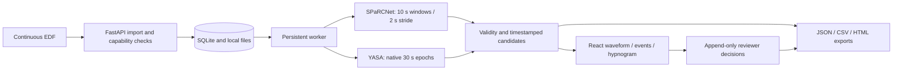

# NeuroScope architecture

Current implementation · 15 November 2026

NeuroScope is a local single-user research workspace. Frozen SPaRCNet and YASA models supply predictions; NeuroScope handles EDF ingestion, input validation, time alignment, background execution, review, and export. There is no LLM generating diagnoses and no user labeling or training step.

## Data and execution

`signals.py` validates continuous EDF, decodes native per-channel rates including EDF+ annotation channels, records file hashes, and supports bounded waveform reads. `open_channels.py` defines model-specific montage contracts and aliases. Unsupported tasks remain unavailable while waveform review remains possible.

`api.py` provides import, analysis, results, scores, waveform, review, and export endpoints. `db.py` stores recordings, runs and append-only annotations. Only one worker owns a data directory; queued jobs recover on restart. The launcher starts both API and worker. The API rejects non-local browser write origins.

`models.py` verifies registry readiness and starts isolated inference subprocesses. `open_inference.py` performs real CPU inference; input annotations are never used as target labels. Cancellation terminates the subprocess. Model errors remain explicit and never switch to the demo.

## Model contracts

SPaRCNet uses a pinned author architecture and checkpoint, 16 ordered bipolar channels, 200 Hz samples in microvolts, FIR filtering and clipping. Ten-second windows start every two seconds. Processing uses ten-minute chunks with 30-second filter context. The six classes are Other, seizure, LPD, GPD, LRDA and GRDA. The setup script verifies the original checkpoint hash before loading its legacy pickle and converts it to a tensor-only state dictionary with an output-equivalence probe.

YASA 0.6.5 uses its bundled pretrained LightGBM classifiers and automated feature extraction. Features are computed over the whole selected recording to preserve temporal context. EEG is required; appropriate EOG/EMG are optional. Native 30-second scores map to Awake/N1/N2/N3/REM without resampling the score timeline. Low-confidence epochs remain uncertain; partial epochs remain unscored.

There is no public broad normal/abnormal model in this configuration. MORGOTH is a separately configured legacy option, not a fallback or a dependency of public analysis.

## Timing, evidence and review

`pipeline.py` converts scores into estimated intervals using recorded hysteresis/persistence settings. Invalid or absent windows cannot be bridged. Score coverage describes the timeline assigned to model outputs; it is separate from comprehensive signal-quality assessment.

All timestamps are recording-relative seconds. Predicted intervals retain window support ranges. Raw scores, validity masks, model checksums, source revisions, preprocessing parameters and class order are saved per run. Display re-referencing does not alter inference. Reviews add decisions and corrections without modifying original predictions.

## Boundaries

This architecture supports local offline review, not public multi-user clinical hosting. No emergency alerts, diagnosis, seizure forecasting, apnea analysis, generalized abnormality conclusions, authentication or clinical validation are provided. Measured behavior and remaining evaluation gaps are in [BUILD_REPORT.md](BUILD_REPORT.md) and [VALIDATION.md](VALIDATION.md).
